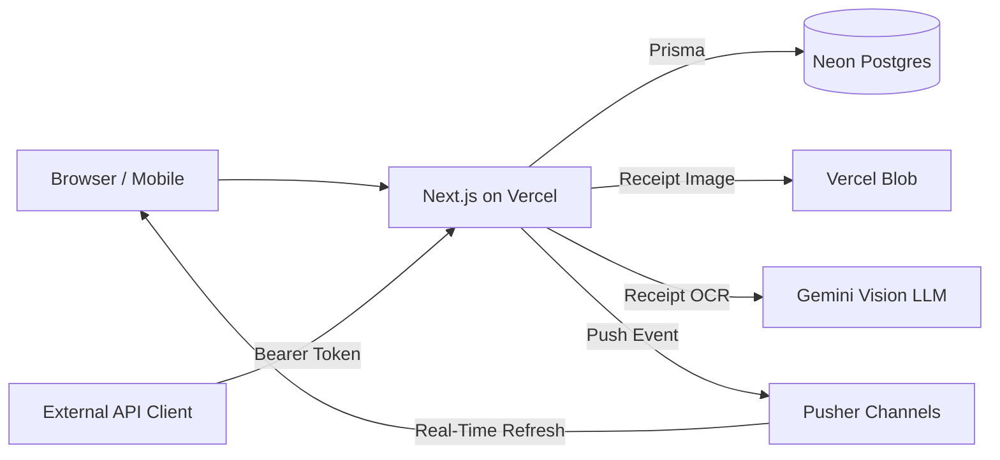
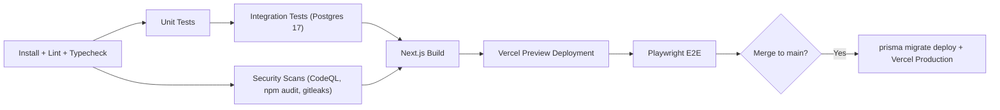

# SlashSplit — Project Plan

CS6983 Project 2 · Pair Project (**Theodore Pei** & **Marcus Ramos**) · Due **2026-11-12 (Thu) 23:59**

## 1. One-Line Summary

A shared-expense web app for roommates: snap a receipt, let AI turn it into an item list, "slash" anyone who didn’t share a specific item, and always see who owes whom with the fewest transfers to settle up.

## 2. Course Requirements Mapping

| Assignment Requirement | How SlashSplit Satisfies It |
|---|---|
| Complete full-stack (frontend + backend + DB) | Next.js App Router + `/api/v1` route handlers + PostgreSQL (Neon) |
| Authentication (JWT or OAuth) | Better Auth: Google OAuth + JWT cookie-cache session |
| 3+ distinct features | Households & invite codes, itemized/equal/ratio expense splitting, balances & greedy settlement, AI receipt scanning |
| Real-time updates OR complex state | Both: interactive per-item participant slash editor + Pusher real-time balance refresh |
| Public API with documentation | `/api/v1` REST endpoints + personal Bearer API tokens + OpenAPI 3.1 (`/api/openapi.json`) & Swagger UI (`/api/docs`) |
| Professional UI/UX | Tailwind CSS 4, mobile-first (360 px for snapping receipts in-store) & desktop (1280 px), light & dark mode |
| TDD (red → green → refactor) | Failing tests committed separately (`test(...)`) before implementation (`feat(...)`), merged with merge commits (see §9) |
| Unit + Integration + E2E tests | Vitest (unit) + Vitest against real PostgreSQL (integration) + Playwright (E2E) |
| Multi-stage CI, PR previews, security scans, auto-deploy | GitHub Actions + CodeQL + npm audit + gitleaks + Dependabot + Vercel + Neon (see §10) |
| Shared `AGENTS.md` | Jointly maintained by **Theodore Pei** and **Marcus Ramos**, updated every sprint (see §11) |
| 2+ sprints, 5+ issues per sprint | Sprint 1 has 8 issues; Sprint 2 has 7 active issues (see §12, [`docs/sprints/sprint1.md`](sprints/sprint1.md), [`docs/sprints/sprint2.md`](sprints/sprint2.md)) |
| 3+ standups per partner per sprint | Daily standup log per partner in `docs/sprints/` |
| 5+ PR reviews per partner | One issue per branch/PR: Marcus reviews Theodore’s Sprint 1 PRs; Theodore reviews Marcus’s Sprint 2 PRs |

## 3. Features

| # | Feature | Sprint |
|---|---|---|
| F1 | Households: create a household and invite roommates with an 8-character invite code | Sprint 1 |
| F2 | Expense splitting: record itemized expenses (tick/slash who shared each item), one-click equal split, or ratio split | Sprint 1 |
| F3 | Balances & settlement: show each member’s net balance, compute a greedy settlement plan, and mark transfers paid | Sprint 1 |
| F4 | AI receipt scan: upload a receipt photo, parse into an editable draft with validation, and confirm to save | Sprint 2 |
| F5 | Real-time updates: when someone records an expense or settlement, roommates’ balance views update automatically | Sprint 2 |
| F6 | Monthly recurring bills: scheduled monthly bill generation | Sprint 2 (cut first if time-constrained) |
| F7 | Public API: personal Bearer tokens + OpenAPI 3.1 & Swagger UI | Sprint 1 skeleton (#8), Sprint 2 tokens (#13) |

## 4. User Stories & Acceptance Criteria

**US1 — Shared Households**
As a roommate, I want to create a household and invite others so we can track shared bills together.
- Creating a household makes me its `OWNER` and generates a unique 8-character invite code.
- Roommates who join with the invite code appear in the member list in join order.
- Any non-member requesting household data receives `403 Forbidden`.

**US2 — Itemized Expense Splitting**
As the payer, I want to choose who shared each item so people who didn’t have an item pay nothing for it.
- Every household member is ticked on every item by default.
- Unticking ("slashing") a member divides that item’s cost among the remaining ticked participants.
- Ticking only one member assigns the entire item cost to that member.
- The sum of all members’ computed shares equals the receipt total to the exact cent.

**US3 — Balances & Settlement**
As a roommate, I want to see what I owe and to whom at any time.
- The balances view shows each member’s net amount in cents/dollars (positive = others owe them; negative = they owe others).
- The settlement plan uses at most `n − 1` transfers (`n` = number of members).
- Marking a transfer as paid immediately updates both members’ net balances.

**US4 — AI Receipt Scanning**
As the payer, I want to snap a photo of a receipt to prefill items instead of typing them by hand.
- Uploading an image creates an editable `DRAFT` expense.
- When `sum(items) + sum(taxes) !== totalCents`, the mismatch is highlighted in red and saving/confirming is blocked.
- The expense is finalized (`CONFIRMED`) and shares are stored only when the user clicks Confirm.

**US5 — Real-Time Updates**
- When Roommate A confirms an expense or records a settlement, Roommate B’s balances view updates within 3 seconds without a manual page reload.

**US6 — Monthly Recurring Bills (Optional / Descoped First)**
- Generates a monthly rent expense on the 1st of the month, idempotently (at most once per bill per calendar month).

## 5. Split Rules (Pure Functions, 100% TDD)

All monetary amounts use **integer cents** (`amountCents`), never floating-point numbers.

### 5.1 Rounding: Largest-Remainder Method
To divide `X` cents among `k` people: each person first receives `⌊X / k⌋`, and the remaining `X mod k` cents are distributed `1` cent each in member join order.
- Example: `1000` cents across 3 members → `334 / 333 / 333`.

### 5.2 Tax Allocation
Each tax line (e.g., `GST`, `PST`) is allocated across the items carrying that tax code in proportion to item price, rounded via the largest-remainder rule so the allocated tax sums match the receipt tax line to the cent.
- Example: `GST = 50` cents across Chips (`499`) and Soda (`299`) → `31.27 / 18.73` → **`31 / 19`**.

### 5.3 Itemized Allocation Example
Each item’s total cost (`priceCents + allocatedTaxCents`) is split evenly among its ticked participants using §5.1:

| Item | Amount (cents) | Ada | Bo | Cy |
|---|---|---|---|---|
| Milk | 600 | ✅ 200 | ✅ 200 | ✅ 200 |
| Beer (Cy slashed) | 1200 | ✅ 600 | ✅ 600 | ❌ 0 |
| Yogurt (only Cy) | 300 | ❌ 0 | ❌ 0 | ✅ 300 |
| **Total: 2100** | | **800** | **800** | **500** |

### 5.4 Three Split Modes

| Mode | Rule |
|---|---|
| `EQUAL` | Whole bill divided equally across all household members |
| `RATIO` | Whole bill divided by integer member weights (e.g., `40 / 30 / 30`) |
| `ITEMIZED` | Per-item participant selection with proportional tax allocation (§5.3) |

### 5.5 Discounts
A discount is represented as a negative-price item line; by default all members participate, and participants can be adjusted per line. Negative amounts do not attract tax.

### 5.6 Net Balances & Greedy Settlement Plan
- `netCents = paidCents − owedCents + sentSettlementCents − receivedSettlementCents`
- Greedy settlement algorithm: repeatedly match the largest debtor with the largest creditor for `min(-debtor, creditor)`, producing at most `n − 1` transfers.
- Example: `Ada +2000`, `Bo −500`, `Cy −1500` → `Cy pays Ada 1500`, `Bo pays Ada 500`.

## 6. AI Receipt Scanning Flow

Single structured multimodal call to Gemini Flash using `responseSchema`:

```json
{
  "merchant": "Costco",
  "date": "2026-11-01",
  "items": [
    { "name": "Milk 2%", "priceCents": 599, "taxes": [] },
    { "name": "Chips",   "priceCents": 499, "taxes": ["GST"] }
  ],
  "taxes": [ { "code": "GST", "amountCents": 25 } ],
  "totalCents": 1123
}
```

| Step | Action |
|---|---|
| 1 | Upload receipt image (jpg/png/heic/webp ≤ 10 MB) to Vercel Blob |
| 2 | Call Gemini Flash with `responseSchema`, then validate with zod |
| 3 | Save as a `DRAFT` expense |
| 4 | User reviews/edits the draft; if `items + taxes !== totalCents`, highlight in red and block confirmation |
| 5 | On Confirm, mark `CONFIRMED` and compute/persist `ExpenseShare` rows |

- Unit, integration, and CI tests never call the live Gemini API; they use deterministic fixtures in `tests/fixtures/receipts/`.

## 7. Tech Stack

| Layer | Choice |
|---|---|
| Framework | Next.js 16.4 (App Router) + TypeScript (strict) |
| Styling | Tailwind CSS 4 |
| Database | PostgreSQL 17 (Neon in cloud, Docker locally) + Prisma 7.10.1 (`@prisma/adapter-pg`) |
| Authentication | Better Auth 1.7.18: Google OAuth + JWT cookie-cache session; email/password test login enabled only outside production |
| Validation | zod 4 |
| API Docs | OpenAPI 3.1 generated from zod schemas (`/api/openapi.json`) + interactive Swagger UI (`/api/docs`) |
| File Storage | Vercel Blob |
| AI | Gemini API (Flash series with `responseSchema`), key provided by Marcus Ramos in `GEMINI_API_KEY` |
| Real-Time | Pusher Channels |
| Testing | Vitest 5 (unit & integration), Playwright 1.64 (E2E on desktop & mobile viewports) |
| CI/CD | GitHub Actions + Vercel |
| Security | CodeQL, `npm audit`, gitleaks, Dependabot |

## 8. Architecture



### 8.1 Data Model

| Table | Primary Fields |
|---|---|
| `User` | `id`, `email`, `name`, `image`, `emailVerified` |
| `Household` | `id`, `name`, `inviteCode`, `createdAt` |
| `Membership` | `userId`, `householdId`, `role` (`OWNER` / `MEMBER`), `joinedAt` |
| `Expense` | `id`, `householdId`, `payerId`, `merchant`, `date` (`YYYY-MM-DD`), `totalCents`, `splitMode`, `status` (`DRAFT` / `CONFIRMED`), `receiptUrl` |
| `ExpenseItem` | `id`, `expenseId`, `name`, `priceCents`, `taxCodes`, `sortOrder` |
| `ItemParticipant` | `itemId`, `userId` |
| `ExpenseTax` | `id`, `expenseId`, `code`, `amountCents`, `sortOrder` |
| `ExpenseWeight` | `expenseId`, `userId`, `weight` (used in `RATIO` mode) |
| `ExpenseShare` | `expenseId`, `userId`, `amountCents` (computed shares persisted on confirm/save) |
| `Settlement` | `id`, `householdId`, `fromUserId`, `toUserId`, `amountCents`, `paidAt` |
| `ApiToken` | `id`, `userId`, `name`, `tokenHash`, `lastUsedAt`, `createdAt` |

### 8.2 Public REST API (`/api/v1`)

| Method | Path | Purpose |
|---|---|---|
| `GET` / `POST` | `/api/v1/households` | List caller’s households / create a household |
| `POST` | `/api/v1/households/join` | Join a household by invite code |
| `GET` | `/api/v1/households/{id}/members` | List members in join order |
| `GET` / `POST` | `/api/v1/households/{id}/expenses` | List expenses / record an expense |
| `GET` / `PATCH` / `DELETE` | `/api/v1/households/{id}/expenses/{eid}` | View / update / delete an expense |
| `POST` | `/api/v1/households/{id}/expenses/{eid}/confirm` | Confirm a draft receipt expense |
| `POST` | `/api/v1/households/{id}/receipts/scan` | Upload a receipt image and create a draft expense |
| `GET` | `/api/v1/households/{id}/balances` | Compute net balances per member |
| `GET` | `/api/v1/households/{id}/settlement-plan` | Compute greedy settlement transfers |
| `POST` | `/api/v1/households/{id}/settlements` | Record a completed transfer |
| `GET` / `POST` / `DELETE` | `/api/v1/tokens` | Manage personal Bearer API tokens |
| `GET` | `/api/openapi.json`, `/api/docs` | OpenAPI 3.1 JSON spec & Swagger UI |

Every `/api/v1/households/{id}/...` route verifies membership first and responds with `403` for non-members (covered by integration tests).

### 8.3 Directory Layout

```
src/
  app/                  Next.js pages and layouts
  app/api/v1/           Public REST API route handlers (parse, authorize, call services)
  lib/split/            Pure split & settlement functions (no I/O, no Prisma)
  lib/receipt/          Gemini receipt extraction & zod validation
  lib/schemas/          Shared zod schemas for routes, server actions, and OpenAPI
  server/               Database service layer (only place that calls Prisma)
prisma/                 Prisma schema and SQL migrations
tests/unit/             Vitest unit tests
tests/integration/      Vitest integration tests against real PostgreSQL
tests/fixtures/         Deterministic receipt JSON fixtures
e2e/                    Playwright end-to-end specs
docs/                   Project plan, sprint logs, architecture, schema, setup, AI usage
AGENTS.md               Shared AI coding agent rules
```

## 9. Testing & TDD Workflow

| Layer | Tool | Coverage |
|---|---|---|
| Unit | Vitest | `src/lib/split/` rules, OpenAPI spec completeness, receipt parsing/validation |
| Integration | Vitest + PostgreSQL | API route handlers + Prisma services + 401/403 authorization checks |
| E2E | Playwright | Sign-in → create/join household → record itemized & equal expenses → check balances → mark transfer paid |

**TDD in Git History (`Red → Green → Refactor`)**

| Commit | Contents | Branch CI |
|---|---|---|
| `test(<scope>): <rule> (#n)` | Failing tests only | Red (expected) |
| `feat(<scope>): <summary> (#n)` | Implementation making the tests pass | Green |
| `refactor(<scope>): <summary> (#n)` | Cleanup without behavior change | Green |

## 10. CI/CD Pipeline



## 11. AI Workflow (`AGENTS.md` & `docs/ai-usage.md`)

- Primary AI IDE harness: **Antigravity** / **Claude Code**, governed by [`AGENTS.md`](../AGENTS.md).
- Both partners (**Theodore Pei** and **Marcus Ramos**) maintain and commit updates to `AGENTS.md` across Sprint 1 and Sprint 2.
- Prompt engineering patterns, AI failure modes, and rule updates are logged in `docs/ai-usage.md`.

## 12. Sprint Plan

The project is organized into three milestones with clear ownership and cross-partner PR reviews:

- **[Sprint 1 Plan (`docs/sprints/sprint1.md`)](sprints/sprint1.md)** (**2026-11-07 – 2026-11-10**): Core foundation, CI/CD, authentication, households, split & settlement engine, manual expense recording, balances UI/API, and OpenAPI/Swagger skeleton.
  - **Development Lead**: **Theodore Pei** (Issues `#1`–`#8`)
  - **PR Review & Merge Lead**: **Marcus Ramos** (Reviews and approves Sprint 1 PRs)
- **[Sprint 2 Plan (`docs/sprints/sprint2.md`)](sprints/sprint2.md)** (**2026-11-10 – 2026-11-13**): AI receipt scanning, draft confirmation UI, real-time Pusher updates, public API Bearer tokens, preview E2E suite, UI polish, and final documentation.
  - **Development Lead**: **Marcus Ramos** (Issues `#9`, `#10`, `#11`, `#13`, `#14`, `#15`, `#16`)
  - **PR Review & Merge Lead**: **Theodore Pei** (Reviews and approves Sprint 2 PRs)
- **Sprint 3 (Project Wrap-Up)**: End-to-end product demo video recording, individual reflections, final documentation review, and submission chores (**Theodore Pei** + **Marcus Ramos**).

## 13. Deliverables Checklist

| Deliverable | Location | Owner |
|---|---|---|
| README | `README.md` | Theodore Pei + Marcus Ramos |
| Interactive API Docs & Guide | `/api/docs` + `docs/api.md` | Theodore Pei (`#8`) + Marcus Ramos (`#13`, `docs/api.md`) |
| Architecture Diagram | `docs/architecture.md` (Mermaid) | Theodore Pei |
| Database Schema Diagram | `docs/schema.md` (Mermaid ER diagram) | Marcus Ramos |
| Local Setup & Deployment Guide | `docs/setup.md` | Marcus Ramos |
| Sprint Planning, Standups & Retrospectives | `docs/sprints/` | Theodore Pei + Marcus Ramos |
| AI Usage Log | `docs/ai-usage.md` | Theodore Pei + Marcus Ramos |
| Partner Contribution Log | `docs/contributions.md` | Theodore Pei + Marcus Ramos |
| 10-Minute Demo Video | Linked in `README.md` | Theodore Pei + Marcus Ramos |
| Production Deployment URL | `https://slashsplit.vercel.app` (in `README.md`) | Theodore Pei |
| Individual 300-Word Reflection | Submitted individually on Canvas | Each partner separately |

## 14. Risk Mitigation

| Risk | Mitigation |
|---|---|
| AI receipt extraction inaccuracies | AI outputs only a `DRAFT` expense; manual editing and validation gate confirmation |
| Tight schedule | Cut `#12` (monthly recurring rent cron) first; core app already exceeds 3+ distinct features |
| Playwright cannot automate Google OAuth login | Email/password test login enabled strictly when `NODE_ENV !== "production"` |
| Floating-point rounding drift | All amounts stored and computed as integer cents (`*Cents`) with sum-assertion tests |
| Unbalanced reviews or commits | Sprint 1 implemented by Theodore & reviewed by Marcus; Sprint 2 implemented by Marcus & reviewed by Theodore |
