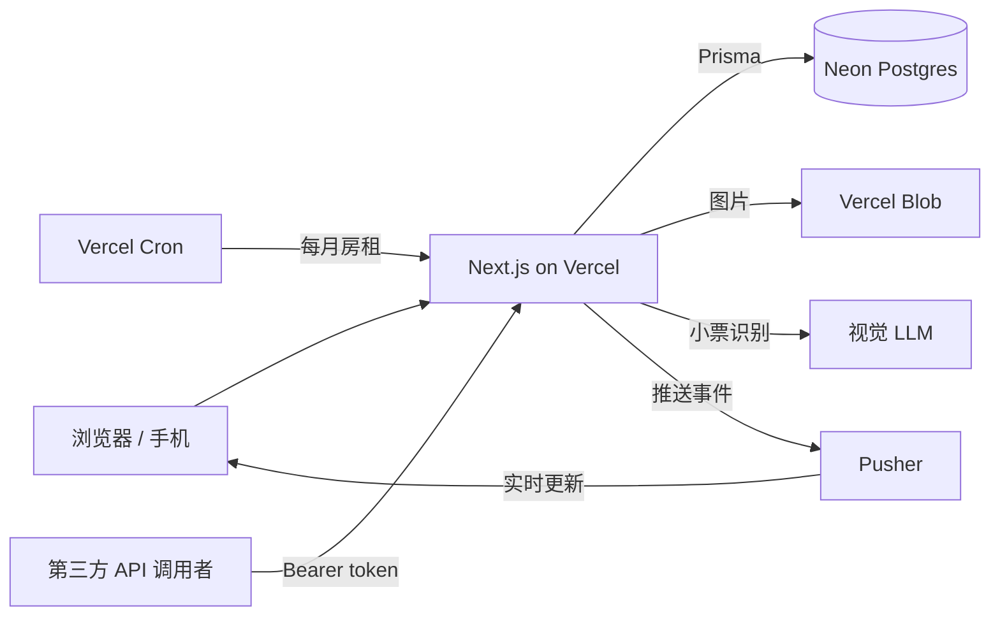
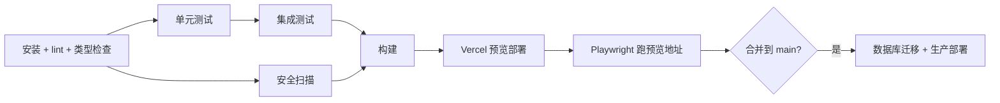

# SlashSplit（暂定名）项目方案

CS6983 Project 2 · 双人项目 · 截止 2026-11-12（周四）23:59

## 1. 一句话

室友合租记账网站：拍小票，AI 识别成商品清单；每个商品可以 slash 掉不吃的人；随时显示谁欠谁，给出转账方案。

## 2. 作业要求对照

| 作业要求 | 我们怎么满足 |
|---|---|
| 全栈（前端 + 后端 + 数据库） | Next.js + API routes + PostgreSQL |
| 认证（JWT 或 OAuth） | Better Auth：Google OAuth + JWT session |
| 3 个以上功能 | 合租房间、按商品记账、结算、AI 扫小票、每月房租 |
| 实时更新或复杂状态 | 两个都有：按商品分账的编辑状态；Pusher 实时刷新余额 |
| 公开 API + 文档 | `/api/v1` + 个人 API token + Swagger UI |
| 专业 UI/UX | Tailwind，适配手机（在超市当场拍小票） |
| TDD | 失败测试单独 commit，之后再写实现（见 §9） |
| 单元 + 集成 + E2E | Vitest + Vitest（连真实 Postgres）+ Playwright |
| 多阶段 CI、PR 预览、安全扫描、自动部署、环境管理 | GitHub Actions + Vercel + Neon 分支（见 §10） |
| AGENTS.md | 两人共同维护，每个 sprint 更新（见 §11） |
| 2 个以上 sprint，每个 5 个以上 issue | Sprint 1 有 8 个，Sprint 2 有 8 个（见 §12） |
| 每人每 sprint 3 次以上 standup | 每天一条，每人每 sprint 3 条 |
| 每人 5 次以上 PR review | 一个 issue 一个 PR，每人 review 对方约 8 个 |

## 3. 功能

| # | 功能 | Sprint |
|---|---|---|
| F1 | 合租房间：创建房间，用邀请码拉室友 | 1 |
| F2 | 按商品记账：录入商品，每个商品勾选谁分；也可以一键平分或整单按比例分 | 1 |
| F3 | 余额 + 结算：随时显示谁欠谁，给出转账方案，记录"已转账" | 1 |
| F4 | AI 扫小票：拍照，识别成草稿，校验，确认后保存 | 2 |
| F5 | 实时更新：有人记账，其他人页面上的余额马上变 | 2 |
| F6 | 每月房租：每月 1 号自动生成房租账单 | 2（时间不够就砍） |
| F7 | 公开 API：个人 token + Swagger 文档 | 1 骨架，2 完成 |

## 4. 用户故事与验收标准

**US1 合租房间**
作为室友，我想建一个房间并邀请别人，这样我们能一起记账。
- 创建房间后，我是房主，并且拿到一个邀请码
- 别人用邀请码加入后，出现在成员列表里
- 不是成员的人访问房间的任何数据，一律返回 403

**US2 按商品分账**
作为付钱的人，我想按商品决定谁分，这样不吃的人不用付钱。
- 默认每个商品所有成员都分
- 取消勾选某人后，这个商品的钱由剩下的人平分
- 只勾选一个人，这个商品就由他一个人付
- 所有人应付金额之和，等于小票总额，一分不差

**US3 结算**
作为室友，我想随时看到自己欠谁多少。
- 余额页显示每个人的净额（正数是别人欠他，负数是他欠别人）
- 结算方案最多 n−1 笔转账（n 是成员数）
- 标记"已转账"之后，双方余额立即更新

**US4 AI 扫小票**
作为付钱的人，我想拍小票自动填商品，不用手打。
- 上传图片后，得到一份可以编辑的草稿
- 商品之和 + 税之和 ≠ 总额时，标红并且不让保存
- 只有点了"确认"才入库

**US5 实时更新**
- 室友 A 保存了一笔账，室友 B 的余额页在 3 秒内更新，不用刷新

**US6 每月房租**
- 每月 1 号生成一笔房租账单
- 同一个月重复触发，也只生成一笔

## 5. 分账规则（核心算法，纯函数，全部 TDD）

所有金额用**整数分**（`amountCents`），不用浮点数。

### 5.1 舍入：最大余数法
把 X 分钱分给 k 个人：每人先拿 ⌊X/k⌋，剩下的几分钱按成员加入顺序一人 1 分。
- 例：1000 分给 3 人 → 334 / 333 / 333

### 5.2 分税
每种税（GST、PST）按价格比例分到带这种税的商品上，再用最大余数法补齐，保证和小票上的税额一分不差。
- 例：GST 50 分，薯片 499、汽水 299 → 31.27 / 18.73 → **31 / 19**

### 5.3 每个商品的分摊
商品金额 = 价格 + 分到它头上的税；再在勾选的人之间按 5.1 平分。

| 商品 | 金额 | A | B | C |
|---|---|---|---|---|
| 牛奶 | 600 | ✅ 200 | ✅ 200 | ✅ 200 |
| 啤酒（C 不喝） | 1200 | ✅ 600 | ✅ 600 | ❌ |
| 酸奶（只有 C） | 300 | ❌ | ❌ | ✅ 300 |
| **合计 2100** | | **800** | **800** | **500** |

### 5.4 三种分账模式

| 模式 | 规则 |
|---|---|
| `EQUAL` | 整单平分（一键 Split） |
| `RATIO` | 整单按权重分，例如主卧 40、次卧 30、次卧 30 |
| `ITEMIZED` | 按商品勾选（5.3） |

三种模式不混用，一笔账只用一种。

### 5.5 折扣
折扣是一行负价商品，参与人默认和全部成员一样，用户可以改。

### 5.6 余额与结算方案
- 净额 = 我付的 − 我应付的 + 我转出去的 − 我收到的
- 结算用贪心算法：每次让欠最多的人转给被欠最多的人，最多 n−1 笔
- 这不保证全局最少笔数（那是 NP-hard 问题），但几个人的合租足够用
- 例：A +2000、B −500、C −1500 → C 转 A 1500，B 转 A 500

## 6. AI 扫小票

一次调用：图片进，JSON 出，用 JSON schema 强制输出格式。

```json
{
  "merchant": "Costco",
  "date": "2026-11-01",
  "items": [
    { "name": "Milk 2%", "priceCents": 599, "taxes": [] },
    { "name": "Chips",   "priceCents": 499, "taxes": ["GST"] }
  ],
  "taxes": [ { "code": "GST", "amountCents": 25 } ],
  "totalCents": 1123
}
```

| 步骤 | 做什么 |
|---|---|
| 1 | 图片存进 Vercel Blob（限 jpg/png/heic，10 MB 以内） |
| 2 | 调 Gemini，拿到上面的 JSON，再用 zod 校验格式 |
| 3 | 存成 `DRAFT` 状态的账单 |
| 4 | 用户在确认页修改；校验不通过就标红，不让保存 |
| 5 | 确认后改为 `CONFIRMED`，计算每人分摊并存库 |

- AI 和手动录入进的是同一份商品清单，AI 出问题时核心功能照样能用
- 测试和 CI 里不调真 AI，用固定的 JSON 样例代替（`tests/fixtures/receipts/`）

## 7. 技术栈

| 层 | 选型 |
|---|---|
| 框架 | Next.js（App Router）+ TypeScript |
| 样式 | Tailwind |
| 数据库 | PostgreSQL（Neon）+ Prisma |
| 认证 | Better Auth：Google OAuth + JWT session（cookie cache 用 JWT）；测试环境另开账号密码登录 |
| 校验 | zod |
| API 文档 | 从 zod 生成 OpenAPI，`/api/docs` 用 Swagger UI 展示 |
| 文件存储 | Vercel Blob |
| AI | Gemini API（Flash 系列，用 `responseSchema` 结构化输出），key 由 Jiaming 提供，存在 `GEMINI_API_KEY` |
| 实时 | Pusher Channels（免费版） |
| 定时任务 | Vercel Cron |
| 测试 | Vitest、Testing Library、Playwright |
| CI/CD | GitHub Actions + Vercel |
| 安全 | CodeQL、npm audit、gitleaks、Dependabot |

## 8. 架构



### 8.1 数据模型

| 表 | 主要字段 |
|---|---|
| `User` | id, email, name, image |
| `Household` | id, name, inviteCode, createdAt |
| `Membership` | userId, householdId, role（`OWNER`/`MEMBER`）, joinedAt |
| `Expense` | id, householdId, payerId, merchant, date, totalCents, splitMode, status（`DRAFT`/`CONFIRMED`）, receiptUrl |
| `ExpenseItem` | id, expenseId, name, priceCents, taxCodes |
| `ItemParticipant` | itemId, userId |
| `ExpenseTax` | id, expenseId, code, amountCents |
| `ExpenseWeight` | expenseId, userId, weight（仅 `RATIO` 模式） |
| `ExpenseShare` | expenseId, userId, amountCents（确认时算好存库，算余额用） |
| `Settlement` | id, householdId, fromUserId, toUserId, amountCents, paidAt |
| `RecurringBill` | id, householdId, name, amountCents, payerId, dayOfMonth |
| `RecurringRun` | billId, month（两列联合唯一，防止重复生成） |
| `ApiToken` | id, userId, name, tokenHash, lastUsedAt |

### 8.2 API（`/api/v1`）

| 方法 | 路径 | 作用 |
|---|---|---|
| GET / POST | `/households` | 我的房间列表 / 创建房间 |
| POST | `/households/join` | 用邀请码加入 |
| GET | `/households/{id}/members` | 成员列表 |
| GET / POST | `/households/{id}/expenses` | 账单列表 / 新建 |
| GET / PATCH / DELETE | `/households/{id}/expenses/{eid}` | 查看 / 修改 / 删除 |
| POST | `/households/{id}/expenses/{eid}/confirm` | 草稿确认入库 |
| POST | `/households/{id}/receipts/scan` | 上传小票，返回草稿 |
| GET | `/households/{id}/balances` | 每人净额 |
| GET | `/households/{id}/settlement-plan` | 转账方案 |
| POST | `/households/{id}/settlements` | 记录已转账 |
| GET / POST | `/households/{id}/recurring-bills` | 每月账单 |
| GET / POST / DELETE | `/tokens` | 管理个人 API token |
| GET | `/api/openapi.json`、`/api/docs` | OpenAPI 文档、Swagger UI |

每个 `/households/{id}/...` 路由都先检查调用者是不是成员；这条检查要有集成测试。

### 8.3 目录结构

```
src/
  app/                  页面
  app/api/v1/           API 路由（只做参数解析和权限检查）
  lib/split/            分账算法（纯函数）
  lib/receipt/          AI 调用 + 解析
  server/               数据库操作（service 层）
prisma/                 schema + migrations
tests/unit/             单元测试
tests/integration/      集成测试（真实 Postgres）
tests/fixtures/         小票 JSON 样例
e2e/                    Playwright
docs/                   架构图、sprint 记录、standup、回顾、AI 使用记录
AGENTS.md
```

## 9. 测试与 TDD

| 层 | 工具 | 测什么 |
|---|---|---|
| 单元 | Vitest | `lib/split/` 全部规则、小票 JSON 解析、校验 |
| 集成 | Vitest + 真实 Postgres | API 路由 + 数据库 + 权限（非成员返回 403） |
| E2E | Playwright | 登录 → 建房间 → 记一笔按商品分的账 → 看余额 → 结算 |

**TDD 怎么在 Git 历史里体现**

| Commit | 内容 | 状态 |
|---|---|---|
| `test: itemized split excludes slashed member` | 只有测试 | CI 红 |
| `feat: implement itemized split` | 实现 | CI 绿 |
| `refactor: extract largest-remainder helper` | 整理 | CI 绿 |

- 写测试前，先把验收标准（§4）给 AI，让它先生成失败测试
- 测试先写、单独 commit，不能和实现放在同一个 commit

## 10. CI/CD



| 阶段 | 触发 | 内容 |
|---|---|---|
| 检查 | 每个 PR | `lint`、`tsc --noEmit` |
| 测试 | 每个 PR | 单元测试；集成测试用 GitHub Actions 的 Postgres service |
| 安全 | 每个 PR + 每周一次 | CodeQL、`npm audit --audit-level=high`、gitleaks |
| 预览 | 每个 PR | Vercel 自动出预览地址；Neon 给这个 PR 开一个数据库分支 |
| E2E | 预览部署好之后 | Playwright 跑预览地址 |
| 生产 | 合并到 main | `prisma migrate deploy` + Vercel 生产部署 |

main 分支保护：必须所有检查通过，并且搭档 approve 一次，才能合并。

**环境**

| 环境 | 数据库 | 登录 | AI |
|---|---|---|---|
| 本地 | Docker Postgres 或 Neon dev 分支 | Google + 测试账号 | 真调用（自己的 key） |
| CI | GitHub Actions Postgres | 测试账号 | 固定 JSON 样例 |
| 预览 | 每个 PR 一个 Neon 分支 | Google + 测试账号 | 真调用 |
| 生产 | Neon main | 只有 Google | 真调用 |

密钥只放在 Vercel 和 GitHub Secrets 里；仓库里只提交 `.env.example`。

## 11. AI 工作流（AI Mastery 30 分）

主力工具：**Antigravity**。

**AGENTS.md 要写的内容**
- 技术栈和常用命令（dev、test、e2e、migrate）
- TDD 规则：先写失败测试并单独 commit，再写实现
- 金额一律整数分；测试里不调真 AI
- 目录约定：算法只放 `lib/split/`，API 路由不写业务逻辑
- PR 检查清单

**留证据**
- `docs/ai-usage.md`：每个 sprint 记几条好用的 prompt、AI 犯过的错、我们怎么修 AGENTS.md
- AGENTS.md 每个 sprint 至少更新一次，两人都要有 commit

## 12. Sprint 计划

| 时间 | 阶段 |
|---|---|
| 11/6（五） | 两人一起做 sprint 计划；开好 GitHub、Vercel、Neon、Google OAuth、Pusher 账号 |
| 11/7（六）– 11/9（一） | Sprint 1 |
| 11/10（二）– 11/12（四） | Sprint 2（先砍 #12 每月房租） |
| 11/12（四） | 文档、demo 视频、个人反思 |

估算单位是故事点（1、2、3、5）。甲 = Jiaming，乙 = 搭档。

### Sprint 1：能记账、能结算

| # | Issue | 点数 | 负责人 |
|---|---|---|---|
| 1 | 项目骨架 + Prisma + Neon + Vercel 生产部署 | 3 | 甲 |
| 2 | CI：lint、类型检查、单元、集成、安全扫描 | 3 | 乙 |
| 3 | 登录：Google + 测试账号 | 3 | 乙 |
| 4 | 合租房间 + 邀请码 | 3 | 甲 |
| 5 | 分账算法（§5.1–5.5） | 5 | 甲 |
| 6 | 手动记账页面 + API（按商品勾选） | 5 | 乙 |
| 7 | 余额 + 结算方案 + 记录已转账 | 3 | 甲 |
| 8 | OpenAPI + Swagger 骨架 | 2 | 乙 |

### Sprint 2：AI、实时、上线

| # | Issue | 点数 | 负责人 |
|---|---|---|---|
| 9 | 小票上传 + AI 识别成草稿 | 5 | 甲 |
| 10 | 草稿确认页：校验标红、可编辑 | 3 | 乙 |
| 11 | 实时更新（Pusher） | 3 | 乙 |
| 12 | 每月房租 + Cron | 3 | 甲 |
| 13 | 公开 API token + 文档补全 | 3 | 乙 |
| 14 | Playwright E2E 跑在预览地址上 | 3 | 甲 |
| 15 | PR 预览 + Neon 分支 + 生产自动迁移 | 2 | 乙 |
| 16 | UI 打磨 + 手机适配 | 3 | 甲 + 乙 |

**每个 sprint 要留下的记录**（放在 `docs/sprints/`）
- 计划会：两人都在，记下选了哪些 issue、怎么估的点
- standup：每人每天一条（昨天做了什么、今天做什么、卡在哪）
- 回顾：好的、不好的、对搭档的反馈、下个 sprint 改什么

## 13. 交付清单

| 交付物 | 位置 | 负责人 |
|---|---|---|
| README | `README.md` | 甲 + 乙 |
| API 文档 | `/api/docs` + `docs/api.md` | 乙 |
| 架构图 | `docs/architecture.md`（mermaid） | 甲 |
| 数据库 schema 图 | `docs/schema.md`（mermaid ER 图） | 乙 |
| 本地运行和部署指南 | `docs/setup.md` | 乙 |
| Sprint 回顾 | `docs/sprints/` | 甲 + 乙 |
| 贡献记录 | `docs/contributions.md` | 甲 + 乙 |
| 10 分钟 demo 视频 | 链接放进 README | 甲 + 乙 |
| 生产地址 | 放进 README | 甲 |
| 个人反思（300 字） | 各自在 Canvas 单独提交 | 各自 |

## 14. 风险

| 风险 | 应对 |
|---|---|
| AI 识别不准 | 只出草稿；手动录入永远能用 |
| 11 天太紧 | 先砍 F6 每月房租，再砍比例分 |
| Playwright 没法过 Google 登录 | 测试账号登录只在非生产环境开启 |
| 一个人做太多，扣贡献分 | 按上表分 issue；每人至少 review 5 个 PR |
| 浮点误差 | 全程整数分，并有"分摊之和 = 总额"的测试 |
| 免费额度用完 | Neon、Vercel、Pusher 都用免费版；AI 调用只在用户点"扫描"时发生 |

## 15. 待定

- 搭档是谁，各自负责哪些 issue
- 正式名字（SlashSplit 是暂定名）

## 16. 已定

| 事项 | 决定 |
|---|---|
| AI 服务商 | Gemini，Jiaming 出 key |
| 仓库 | Jiaming 建，加搭档为 collaborator（需要 push 权限） |
