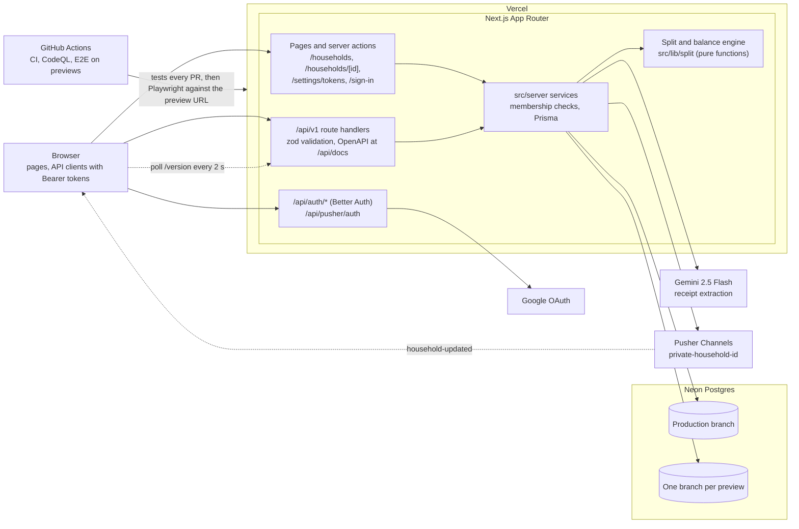

# Architecture

SlashSplit is one Next.js 16 App Router app on Vercel. Pages and the public API share the same services in `src/server/`, and every money calculation goes through the pure split engine in `src/lib/split/`.

## Components

**Browser.** Roommates use the pages; scripts call `/api/v1` with a personal Bearer token. Large receipt photos are compressed in the browser before upload, because Vercel rejects request bodies above about 4.5 MB.

**Pages and server actions** (`src/app/households`, `src/app/settings/tokens`, `src/app/sign-in`). Server components render households, expenses, drafts and balances; forms post to server actions in `actions.ts`, which call the same services as the API.

**`/api/v1` route handlers** (`src/app/api/v1/`). Each handler parses the request with zod, authenticates the session cookie or a Bearer token, checks household membership (403 for non-members), and calls a service. `src/lib/openapi.ts` builds the OpenAPI 3.1 document from the same zod schemas, served at `/api/openapi.json` and rendered with Swagger UI at `/api/docs`. A unit test fails if any route file is missing from the document.

**Services** (`src/server/`). The only code that imports Prisma. They load and save households, expenses, settlements and tokens, call the split engine, and publish real-time events after every balance-changing write. API tokens are stored as SHA-256 hashes only.

**Split and balance engine** (`src/lib/split/`). Pure functions on integer cents. Shares use largest-remainder rounding with ties to the earlier member, and tax is allocated in proportion to the items that carry it. Each function asserts that its shares add up to the total. The settlement plan is greedy: the member who owes the most pays the member owed the most, so n members need at most n−1 transfers.

**Better Auth + Google** (`src/server/auth.ts`, `/api/auth/*`). Sign-in with Google OAuth. The session is a signed JWT cookie cache over a `Session` row. Outside production (local, CI, Vercel previews) a test email/password login is on and rate limiting is off; in production the test login is off and rate limiting is on.

**Gemini** (`src/lib/receipt/`). One call to Gemini 2.5 Flash with a `responseSchema` turns a receipt photo into items, taxes and a total. The reply is validated with zod and saved as a `DRAFT` expense, which only counts toward balances after a roommate reviews it and confirms that items plus taxes equal the total. Tests use fixtures from `tests/fixtures/receipts/` and never call Gemini.

**Pusher** (`src/server/realtime.ts`, `/api/pusher/auth`). After a write, the server publishes `household-updated` on the household's private channel through Pusher's REST API; `/api/pusher/auth` signs a subscription only for members. Without the Pusher environment variables publishing is a no-op, and the household page polls `/api/v1/households/{id}/version` every 2 s. Production currently runs without them, so polling is the active path there.

**Neon Postgres.** Production uses its own Neon project. Each Vercel preview gets its own Neon branch from the Vercel Neon integration, in a separate project, so a preview never shares a host with production. Locally and in CI the database is Postgres 17 in Docker.

**Vercel.** Builds every push to a PR branch as a preview and every merge to `main` as production. `npm run vercel-build` runs `scripts/vercel-build.mjs`, which applies migrations on production builds and on previews whose database is not the production host, then runs `next build`.

**GitHub Actions** (`.github/workflows/`). `ci.yml` runs lint and typecheck → unit → integration (Postgres service) → build, with npm audit and gitleaks; `codeql.yml` runs CodeQL; Dependabot opens dependency PRs. `e2e-preview.yml` runs on every pull request push: it polls the Vercel API until the head commit's preview deployment is ready, then runs Playwright against that deployment's URL as the `E2E (preview)` job. Before Playwright starts, it checks that the preview answers through the protection bypass. Dependabot PRs skip this job because they get no Actions secrets. Environment setup per stage is in [`setup.md`](setup.md).
