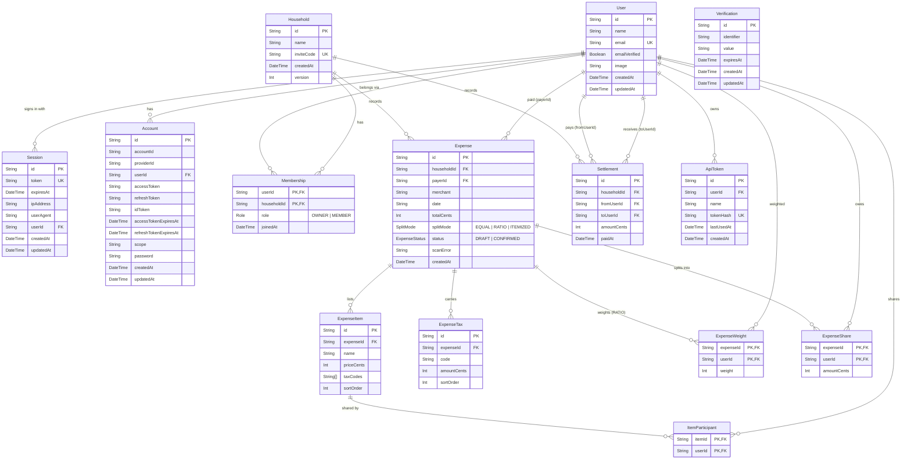

# Database schema

Every model in [`prisma/schema.prisma`](../prisma/schema.prisma). Money columns are integer cents
(`*Cents`); `Expense.date` is a `YYYY-MM-DD` string. Deleting a user or household cascades to the rows
that reference it.

| Model | Purpose |
|---|---|
| `User`, `Session`, `Account`, `Verification` | Better Auth tables (#3). `Account.password` holds the hashed test-login password. |
| `Household`, `Membership` | A household and its members (#4). `joinedAt` orders members for split rounding; `version` is bumped on every balance-changing write so clients know when to refresh (#11). |
| `Expense` | One expense (#6). A scanned receipt starts as `DRAFT` (with `scanError` if the scan failed) and counts toward balances only once `CONFIRMED` (#9, #10). |
| `ExpenseItem`, `ItemParticipant`, `ExpenseTax` | Itemized lines, who shared each line, and the tax lines the items' `taxCodes` refer to. |
| `ExpenseWeight` | Per-member weights for `RATIO` splits. |
| `ExpenseShare` | Each member's computed share of a confirmed expense; balances are built from these and `Settlement`. |
| `Settlement` | A recorded transfer between two members (#7). |
| `ApiToken` | A personal API token (#13); only the SHA-256 hex of the token is stored. |
